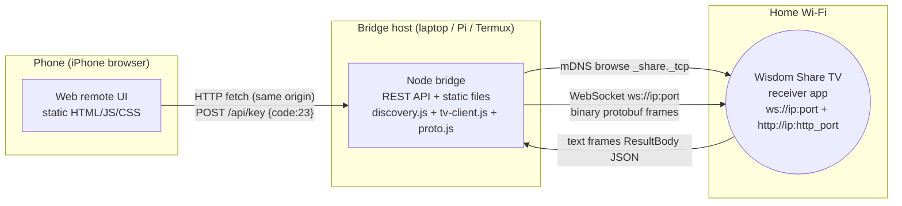

# Architecture

## Why a bridge

A browser tab cannot speak the TV's protocol directly:

- Discovery needs mDNS multicast UDP 5353 — browsers cannot join multicast groups or open raw UDP.
- The TV's WebSocket is plain `ws://` on a raw LAN IP; a page served from HTTPS or from a different origin cannot connect without mixed-content/CORS relief, and the TV's server sends no CORS headers.
- Commands are **binary protobuf** frames — fine for browsers, but the discovery/connectivity constraints make direct browser↔TV unreliable at best.

So the phone browser talks to a tiny **bridge** (Node.js, zero dependencies) that lives on the same Wi-Fi and speaks the TV's protocol natively. The bridge is the only network component; the web UI is static files served by the bridge itself (same-origin → no CORS issues at all).

## Diagram

## Bridge components

| File | Role |
|---|---|
| `bridge/proto.js` | hand-rolled protobuf `MessageProto` encoder matching the decompiled serializer (default fields omitted) |
| `bridge/tv-client.js` | WebSocket client to the TV (Node 22 global WebSocket), connect timeout, auto-reconnect, JSON text-frame responses surfaced as events |
| `bridge/discovery.js` | pure-Node mDNS browser: PTR query for `_share._tcp.local`, SRV/TXT/A parsing, TXT decode |
| `bridge/validate.js` | every inbound parameter is validated against whitelists (keycodes, text shape, IP/port, package names) |
| `bridge/server.js` | HTTP server: static UI + REST API; optional `BRIDGE_TOKEN`; binds `0.0.0.0` (LAN) by default, `HOST=127.0.0.1` for loopback-only |

API surface (all JSON; all validated; no shell, no arbitrary URLs):

- `GET /api/status` — connection state + last TV response
- `GET /api/discover` — run an mDNS scan and return devices
- `POST /api/connect` `{ip, port?}` — open the TV socket (port auto-fallbacks: given → TXT websocket_port → SRV port)
- `POST /api/disconnect`
- `POST /api/key` `{code}` — KEY_EVENT with whitelisted keycode
- `POST /api/text` `{text}` — KEYBOARD_INPUT_EVENT
- `POST /api/mouse` `{}` — MOUSE_CLICK_EVENT
- `POST /api/app/open` `{package}` — HTTP /app/open on the TV (package name regex-validated)
- `POST /api/voice-text` `{text}` — reserved for phase 2 (returns 501 until voice ordinals are confirmed)

## Practical phone-first workflow

1. Bridge host: any always-on machine on the home Wi-Fi (laptop, Raspberry Pi, NAS, or an old Android with Termux). `node bridge/server.js`.
2. Phone: open `http://<bridge-host-ip>:8787`. Add to home screen for an app-like experience.
3. The bridge host must stay awake for the remote to work; when it's off, the UI shows a clear offline error.

## Security posture

- Bridge binds to the LAN; it is never exposed to the internet (no tunnels in this design).
- Optional shared token (`BRIDGE_TOKEN` env) required on all `/api/*` calls when set.
- Strict input validation; only whitelisted keycodes and fixed endpoints; no dynamic URL construction from user input beyond validated IP/port/package.
- The bridge never stores credentials (none exist in the protocol).

## Voice phase design (phase 2)

`web/voice.js` isolates speech so the protocol client never changes:

1. Browser SpeechRecognition (Safari supports it with on-device limits; Chrome/Edge work too; privacy: audio leaves the device unless the platform says otherwise — documented in the UI).
2. A **fixed command grammar** maps recognized text to validated bridge calls. Nothing recognized is passed through raw: unknown utterances are rejected with a hint, and app-launch commands ask for a tap-to-confirm first.
3. A second path (pending evidence) sends the recognized text itself via `GOOGLE_VOICE_FINISH` so the TV's own voice pipeline executes it — blocked only on that event's ordinal.